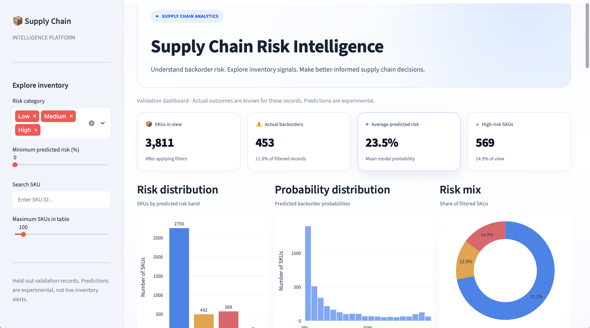

# Retail Supply Chain & Inventory Intelligence

An analytics project that combines SQL-based inventory analysis, machine learning, and an interactive Streamlit dashboard to identify products at risk of backorder.

## Dashboard Preview



## Business Problem

Inventory shortages can disrupt fulfilment and increase operational costs. This project analyses product inventory, demand forecasts, past sales, and supplier-related indicators to identify potential backorder risk and support inventory review decisions.

## Project Features

- **Data analysis:** Examines inventory levels, forecasts, historical sales, and supplier indicators.
- **SQL analytics:** Uses DuckDB SQL queries to investigate backorder rates and inventory patterns.
- **Predictive modelling:** Trains a Random Forest classifier and evaluates it on a separate validation partition.
- **Risk dashboard:** Uses Streamlit and Plotly to explore SKU-level backorder risk.
- **Action reporting:** Generates downloadable CSV and Excel reports to help prioritise inventory reviews.

## Model Evaluation

The current experimental Random Forest model achieved the following results on the validation partition:

| Metric | Result |
|---|---:|
| ROC-AUC | 0.9492 |
| PR-AUC / Average Precision | 0.7282 |
| Precision (backorder class) | 0.5590 |
| Recall (backorder class) | 0.8477 |
| F1-score (backorder class) | 0.6737 |

These metrics describe performance on the available validation partition. They do not guarantee performance on future or live inventory data.

## Dataset

The project uses a version of the Predict Product Backorders dataset. The local training data contains 15,243 rows and the test data contains 3,810 rows.

The training data includes inventory, demand forecasts, historical sales, supplier-related indicators, and a backorder outcome. Raw datasets are excluded from this repository.

## Tech Stack

- Python
- Pandas
- DuckDB SQL
- Scikit-learn
- Streamlit
- Plotly

## Run Locally

1. Clone the repository.
2. Create and activate a Python virtual environment.
3. Install dependencies:

   ```bash
   pip install -r requirements.txt
   ```

4. Place the required source dataset files in `data/raw/`.
5. Run the dashboard:

   ```bash
   streamlit run app.py
   ```

The dashboard and data-processing scripts require the appropriate local dataset files.

## Limitations

- This is an experimental analytics project, not a production inventory system.
- Validation results may not generalise to different suppliers, products, or time periods.
- Feature availability and timing should be confirmed before using predictions operationally.
- Risk categories and suggested actions are decision-support aids, not automatic purchasing instructions.

## Author

Built as a portfolio project demonstrating data analytics, SQL, machine learning, and dashboard development.